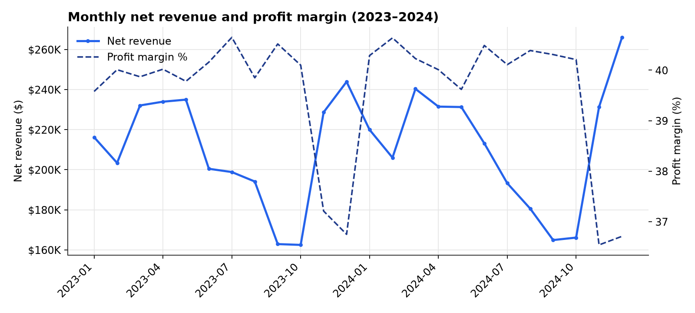
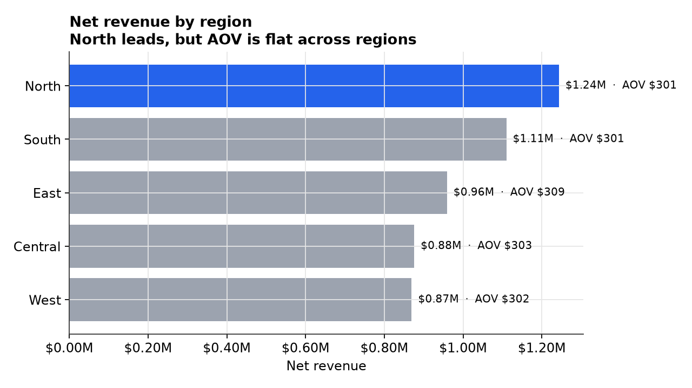
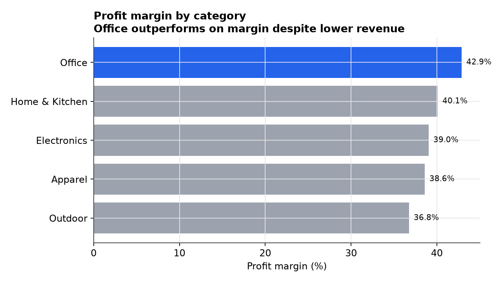
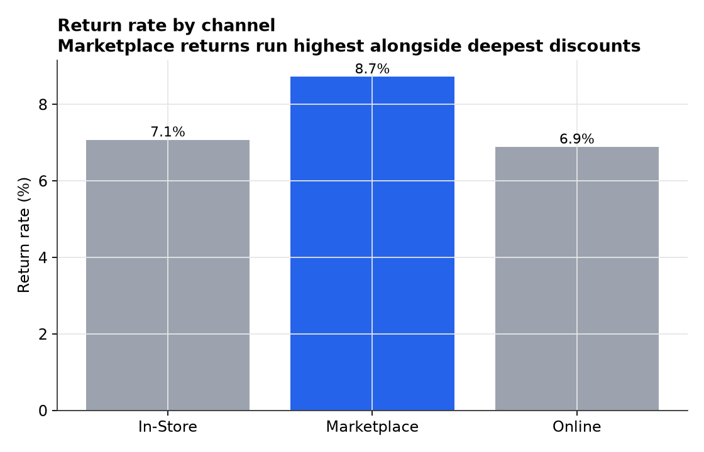

# Retail Performance Intelligence

SQL + Python analysis of a multi-region retail operation — revenue trends,
regional and category profitability, channel return risk, and RFM customer
segmentation, with every number in this README verified by running the query
that produced it.

**Status:** complete, reproducible end-to-end · **Data:** synthetic, seeded, clearly labeled (see [Dataset](#dataset))

## Contents

- [Overview](#overview)
- [Dataset](#dataset)
- [Approach](#approach)
- [Key findings](#key-findings)
- [Project structure](#project-structure)
- [Reproduce it](#reproduce-it)
- [Limitations](#limitations)
- [Technologies](#technologies)

## Overview

**Problem.** A retail operation selling across five regions, five categories,
and three channels (Online / In-Store / Marketplace) needs to know where
revenue and margin are actually coming from — and where growth in one metric
(discounting, Marketplace volume) is quietly costing another (margin, returns).

**Approach.** Model the operation as three related tables (`orders`,
`customers`, `products`), load them into SQLite, and answer five concrete
business questions with SQL — trend, regional ranking, category profitability,
customer segmentation, and channel return risk — then visualize and interpret
each result.

**Result.** Five findings, each tied to a specific query and chart, each with
a stated business recommendation. Full write-up in
[`reports/findings.md`](reports/findings.md).

## Dataset

The dataset is **synthetic and generated by [`src/generate_data.py`](src/generate_data.py)**
with a fixed seed (`SEED=42`) — it does not describe a real company. It was
designed to resemble a realistic retail operation (holiday seasonality,
regional customer distribution, category-level pricing, channel-based discount
behavior, and a return-rate model correlated with discount depth) so the SQL
and analysis approach below transfer directly to a real POS/ERP export with
the same schema.

| Table | Rows | Grain |
|---|---|---|
| `orders` | 18,000 | one row per order line, Jan 2023 – Dec 2024 |
| `customers` | 1,200 | one row per customer |
| `products` | 25 | one row per SKU, across 5 categories |

## Approach

```
generate_data.py  →  CSV (orders, customers, products)
        ↓
   load_db.py      →  SQLite (data/retail.db) + indexes
        ↓
    sql/*.sql       →  5 analytical queries (trend, region, category, RFM, returns)
        ↓
   run_sql.py        →  verified query output  (source of every number below)
build_report_figures.py → reports/figures/*.png (charts, one per business question)
        ↓
  reports/findings.md   →  interpretation + recommendation per finding
```

Every query lives in its own file under [`sql/`](sql/) and is executed, not
just written — [`src/run_sql.py`](src/run_sql.py) runs all five against the
real database and prints the output that the findings below are quoted from.

## Key findings

Full detail, numbers, and recommendations for each: [`reports/findings.md`](reports/findings.md).

### 1. Holiday margin compression
Profit margin holds 39–41% for ten months, then drops to **36.5–37.2%** every
Nov/Dec despite revenue peaking — driven by discount depth, not cost.



### 2. Revenue leadership is a volume story, not a basket-size story
North leads revenue ($1.24M) but average order value is flat ($300–$309)
across all five regions — the gap is order count, not spend per order.



### 3. Highest-revenue category has the lowest margin
Outdoor leads revenue but trails on margin (36.8%); Office is the inverse —
lowest revenue share, highest margin (42.9%) — at a comparable discount rate.



### 4. Marketplace return rate runs ~26% above other channels
8.7% of Marketplace orders are returned vs. 6.9–7.1% elsewhere, alongside the
channel's deepest average discounting.



### 5. A small "Champions" segment drives disproportionate value
RFM segmentation isolates repeat customers with 17–24 orders and $5.2K–$8.7K
in two-year net revenue — the highest-leverage group for a retention program.
See [`sql/04_customer_segmentation_rfm.sql`](sql/04_customer_segmentation_rfm.sql).

## Project structure

```
retail-performance-intelligence/
├── src/
│   ├── generate_data.py         ← synthetic dataset generator (seeded)
│   ├── load_db.py                ← CSV → SQLite
│   ├── run_sql.py                ← executes sql/*.sql, prints verified output
│   └── build_report_figures.py   ← renders reports/figures/*.png
├── sql/
│   ├── 01_monthly_revenue_trend.sql
│   ├── 02_regional_performance.sql
│   ├── 03_category_profitability.sql
│   ├── 04_customer_segmentation_rfm.sql
│   └── 05_channel_return_rate.sql
├── reports/
│   ├── findings.md               ← full write-up: finding → recommendation
│   └── figures/                  ← chart PNGs referenced above
├── data/                         ← generated CSVs + retail.db (gitignored, regenerate locally)
└── requirements.txt
```

## Reproduce it

```bash
pip install -r requirements.txt

python src/generate_data.py          # writes data/*.csv
python src/load_db.py                # builds data/retail.db
python src/run_sql.py                # prints verified output for every query
python src/build_report_figures.py   # writes reports/figures/*.png
```

Everything is seeded (`SEED=42`) — re-running from a clean checkout reproduces
identical data, query output, and figures.

## Limitations

- Data is synthetic; figures illustrate method, not real business performance.
  Full discussion: [`reports/findings.md#limitations`](reports/findings.md#limitations).
- Return-rate/discount correlation is not causal without a controlled test.
- Two years of data captures holiday seasonality once fully, once partially.

## Technologies

Python · pandas · NumPy · SQLite (window functions, CTEs, `NTILE`) · matplotlib

---

Part of [musab-abukaraki-66](https://github.com/musab-abukaraki-66)'s data &
analytics portfolio.
